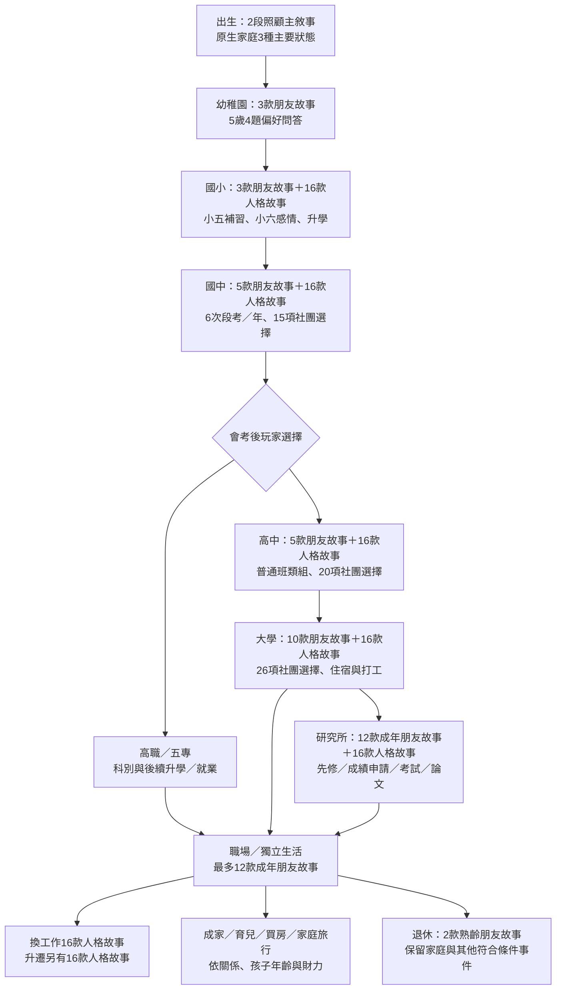

# 各人生階段劇情與觸發機率盤點

盤點對象：v0.7 現有程式，2026-11-09。這是**遊戲設定與排程稽核**，不是現實統計。沒有改動遊戲規則。

## 如何數「幾種劇情」

同一個事件可以重複多年、包含數個選項、再接後續事件，所以不能把「劇情模板數」「每年出現次數」「玩家選項數」混成一個總數。下表分開列出可核對的劇情池。人格故事由玩家的四題答案決定，不是16種各有6.25%隨機機率；社團是選項，不是額外等機率故事。

「固定」表示符合條件後會排入日曆；必須活到日期並推進遊戲才會看到。新階段問答等也可能在前一個事件完成後才排入。未符合學籍、年齡、預算或前置條件時，不會出現或不可選。

## 階段流程



## 可核對的劇情池與排程

| 階段 | 朋友劇情池 | 人格題目／故事 | 其他已接入事件 | 觸發方式 |
|---|---:|---|---|---|
| 出生／未自主 | 0 | 不選年度目標 | 出生介紹；0歲2段照顧故事；未自主成長旁白；早期腸病毒 | 照顧故事固定排入；未自主腸病毒為hash%4=0，約四分之一種子條件 |
| 幼稚園 | 3 | 5歲4題偏好問答；尚無獨立16型幼兒故事池 | 幼兒園入學、照顧旁白、人際／健康年度目標 | 問答固定一次；有自主後每年2次朋友邀約，另可能有4月邀約 |
| 國小 | 3 | 每階段4題＋16款故事擇1 | 每年校園人際衝突；小五／六補習；小六起情書；國中入學 | 固定或條件觸發；術科用D20，感情由選擇／檢定決定 |
| 國中 | 5 | 4題＋16款擇1，家庭／校園／朋友主題 | 每年6次段考；15項社團選擇（11新＋4相容）；補習；升高中／高職／五專 | 符合學籍時固定；社團／升學路線由玩家選擇 |
| 高中 | 5 | 4題＋16款擇1，自我探索主題 | 每年6次段考；20項社團選擇（16新＋4相容）；普通班類組；一般大學3輪／音樂／體育入學 | 學籍與路線條件；不是每人都遇到全部考試 |
| 高職／五專 | 依年齡落入5／12款等池，沒有獨立朋友池 | 沿用高中問題／故事主題 | 科別、段考／打工及符合條件升學 | 部分事件按年齡、部分按學籍；專屬內容仍有限 |
| 大學 | 10 | 4題＋16款擇1，分組與自主生活 | 26項社團選擇（22新＋4相容）；學費；住房；6類兼職；駕照／車輛；修課成績；音樂師培 | 固定／選擇／D20；便宜租屋與騎車事故另有隨機判定 |
| 研究所 | 12（目前用成年朋友池） | 4題＋16款擇1，研究與論文 | 考試／在校成績申請；跨領域先修；碩二至四論文審查 | 入學取決於準備／分數；論文為D20 |
| 職場 | 12；最近學籍仍是大學者可能沿用10款 | 換工作16款；升遷16款；每次4題後擇1 | 13類全職字典職位；進修；每3年升遷評估；年終；5種創業；住房 | 職缺依條件篩選，並非13種等機率；雇用者另有失業風險 |
| 成家育兒（跨階段） | 沿用原階段 | 關係變動可接續事件 | 每名同住未成年孩子2類年度事件：照顧學習安排／生病；每年2次家庭旅行規劃；資產規劃；生育／領養 | 符合條件後固定，細項由玩家選擇；生育有額外機率 |
| 退休 | 2；若仍判為大學學籍，可能沿用10款 | 沒有獨立退休問答池 | 家庭、子女、住房、旅行；兼職機會 | 按年齡與狀態，不是進入退休就固定抽中全部劇情 |

朋友池明細：

- 幼兒3款：積木城堡、交換貼紙、公園尋寶。
- 國小3款：文具店、圖書館、操場。
- 國中5款：文具展、豆花、學生音樂會、自行車道、漫畫。
- 高中5款：麥當勞讀書、球場、演唱會、夜市、街舞發表。
- 大學10款：牛肉麵、咖啡館、電影宵夜、文具展，加上登山、露營、SUP、遊戲夜、書店市集、料理。
- 成年12款：文具展、音樂會、演唱會、河堤、晚餐、咖啡課，加上上述6種活動。
- 熟齡2款：花市早午餐、公園下棋。

## 真正的機率與計算單位

| 事件 | 現行設定 | 條件／分母 |
|---|---|---|
| 4月臨時事件 | 生病／家人需要陪伴／朋友邀約，各1/3 | 已有自主決策；每年4/18三選一，不是三個事件各抽一次 |
| 生病種類 | 每階段3種，以hash%3選擇 | 在生病分支內選種類；種類順序受年齡與壓力影響。不是三個疾病各有1/3年發生率 |
| 固定朋友邀約 | 每年2次，2/8、10/6 | 已有自主；加上4月分支，期望邀約數為2+1/3次／年（活到日期、正常推進假設） |
| 每款朋友故事 | 不設獨立抽中百分比 | 依種子、年份、月份slot輪替，非每次重新均勻抽樣 |
| 原生家庭海外旅行 | 18%／年 | 未滿22歲、家庭小康以上、在世照顧者現金合計>35萬；執行時還需找到可付10萬的家長 |
| 收到告白／自己想告白 | hash%2分支 | 未交往、11歲起並符合年級限制；約半數種子，但不是實測人群比例 |
| 交往階段討論 | 30%／次 | 該階段4題完成、有交往對象且尚未共同成家；這是「談關係」機率，非實際分手機率 |
| 家人談心變糟 | 30%；改善70% | 主動選擇免費家人談心，而且有在世家人 |
| 便宜租屋不安／凶宅 | 12% | 主動選擇便宜未充分看屋的房間 |
| 機車非致命事故 | 1.5%／年度騎車事件 | 已有機車與駕照且選擇繼續騎車 |
| 行業失業 | 服務7%、科技10%、創意12%／年 | 22歲以上、就業、未退休且不是經營自己的事業 |
| 生育嘗試成功 | 典型65%；任一伴侶預設困難15% | 異性伴侶、主動嘗試；失敗不等同診斷。領養目前沒有這個機率抽樣 |
| 正式教師 | 新北156/2222≈7.02%；其他可選地區3% | 已完成本作教師資格條件並選擇應徵；新北是整體教甄代理參數，非音樂科實際個人率；其餘為估值 |
| 一般D20檢定 | 有利骰面數÷20 | 能力、熟練度、難度、背景加成不同，不能固定說入學／升遷／創業都50% |
| 人格16款故事 | 玩家答案決定1款 | 不隨機抽16型，也不顯示人格類型結果 |
| 社團／旅行／買房／創業種類 | 玩家選擇 | 選項數不是等機率分布；預算與資格會隱藏／停用部分選項 |

D20通過率：`max(0, min(20, 21 - DC + modifier)) / 20`，適用目前整數加成且無額外前置資格障礙時。例如DC15、加成0為30%；加成5為55%；加成10為80%。檢定前若資格不足，不能靠20點跳過條件。五科會考及一般升學則保留多顆骰子與後續分發，不等同單次通過率。

所有遊戲機率均未經現實人口／醫療／勞動風險校準。

## 出生背景與自主起點

原生家庭兩次抽樣：父母分住20%、父親出生前已故2.5%。以「父親是否在世」合併，主要狀態可列共同照顧78%、父親在世但分住19.5%、父親已故2.5%；已故前是否分住不另外重複計數。姓名、姓氏、性向、住房、人口加權出生地等是背景參數，不是各一個完整劇本。

**發現一個與舊說明不一致之處：**現行初始INT/WIS各8–16，加上0–11，再除16的自主公式，實際只會得到3或4歲，不會得到2歲。枚舉972種參數組合得3歲628/972≈64.61%、4歲344/972≈35.39%（各輸入均勻獨立假設）。本次僅揭露，未擅改規則；舊人物已存自主年齡也不重抽。

## 需要注意的實作落差

1. 好友劇情目前只有上述池數，重複2次／年並不代表每年新增2篇劇本。幼兒／國小各3款，確實容易重複。
2. `friendScene` 對大學生的判定只檢查最近學籍level，不檢查active；畢業後及退休者可能繼續使用10款大學池。研究生則使用成年池。這是現況，不是新設計。
3. 國高中社團等程式分支可能保留相容選項；15／20／26是可選社團條目數，部分概念相近，不能當成完全獨立長劇本數。
4. 有些事件依年齡、有些依學籍；高職／五專和延畢者未必與理想學制完全一致。
5. 輕量NPC的死亡模型與玩家模型不同，這份表不把所有NPC死亡當成玩家階段劇情的新類別。
6. 各階段「至少看過一次某劇情」或「完整人生遇到某分支」的百分比，還需指定遊玩策略、種子集合及前置條件，不能僅由這張表直接加總。

## 重現盤點

```sh
node node_modules/vite-node/vite-node.mjs scripts/analysis/stage-audit.ts
```

輸出 [STAGE_EVENT_AUDIT.json](STAGE_EVENT_AUDIT.json) 的來源模板清單、故事／問答／社團數量、972種自主參數枚舉，以及每階段一個合成學籍的排程樣本。樣本不是整個階段的總事件數，更不是實際玩家機率。來源：`index.ts`、`life-events.ts`、`life-scenes.ts`、`progression.ts`、`chapters.ts`、`wellbeing.ts` 與各world-data字典。
